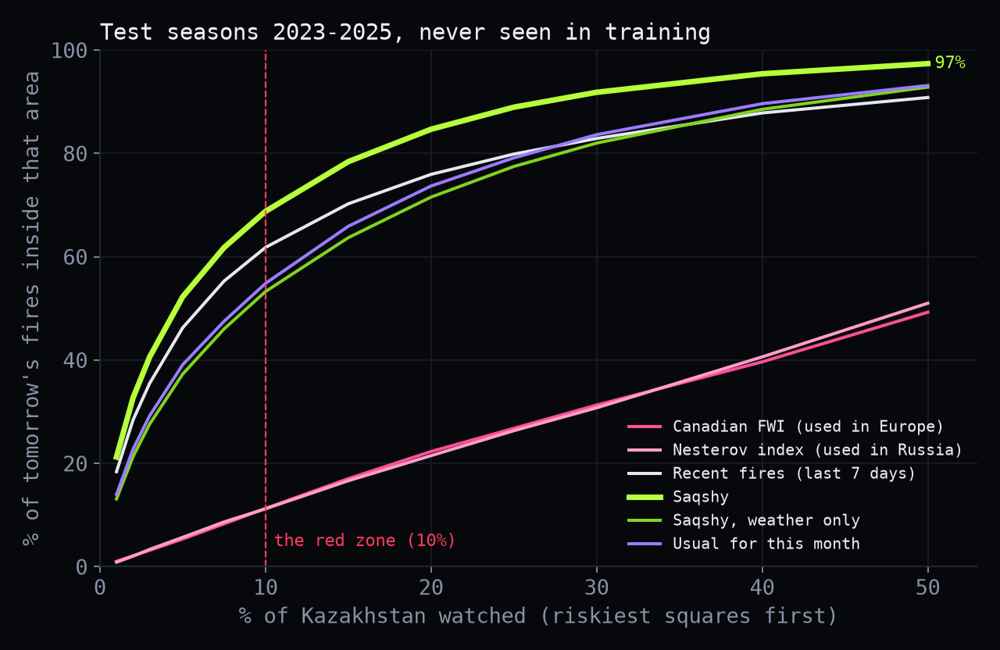
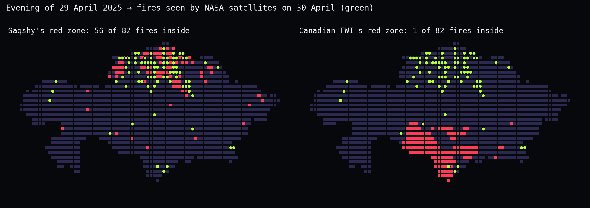

# Saqshy · Сақшы: tomorrow's wildfire risk map for Kazakhstan

**Track:** AI + Climate  
**Team:** Dariya

*This project is a prototype, not an official warning service.*

**Live website:** https://dede-bebe-lele.github.io/saqshy/ · **Notebook (runs end to end):** [`saqshy.ipynb`](saqshy.ipynb) · [Open in Colab](https://colab.research.google.com/github/dede-bebe-lele/saqshy/blob/main/saqshy.ipynb) · **Demo video:** https://youtu.be/AxgE7Zikh4w

## The problem

Every year Kazakhstan's steppe and forests burn. On 8 June 2023 lightning started a fire in the Semey Ormany forest in Abai region; it burned about 60,000 hectares and 15 people died. In 2023 alone forest fires cost the country about 163 billion tenge, according to press reports. Kazakhstan is 2.7 million km², so rangers and the Emergency Ministry can't watch everywhere. Every evening they have to decide **where to send patrols, drones and crews tomorrow**. Classic fire-danger indices (the Canadian FWI, the Nesterov index) use weather alone, so they cannot tell a hot desert with nothing to burn from a dry steppe full of grass.

## What I built

Saqshy cuts Kazakhstan into **1,326 squares** (0.5°, about 55 × 37 km). Every evening it takes, for each square, NASA satellite fire detections and the day's weather, and gives back **tomorrow's fire probability and a national ranking**. The riskiest 10% of squares become a red zone and a short alert in Kazakh, Russian or English that a district can forward to rangers, farmers and herders in one tap.

On the **website** you can replay any evening of the 2023–2025 fire seasons, see Saqshy's map next to where satellites really saw fires the next day, switch to the official Canadian FWI map for comparison, and send the alert to Telegram.

## How it works

**Data.**
- NASA FIRMS VIIRS (S-NPP, 375 m) active fire detections for Kazakhstan, 2012–2025: 1,351,452 vegetation-fire detections after keeping type 0 (vegetation) and dropping low-confidence points.
- NASA POWER daily weather for every square, 2012–2025: max/min temperature, humidity, wind, rain, topsoil and root-zone wetness.
- One row per square per evening for March–November: **5,105,100 square-days**. Target: does the satellite see a fire in the square tomorrow? (3.2% of square-days.)

**Inputs (all known before the forecast day starts).** Today's weather; rain over 7 and 30 days and days since rain; the two standard fire-danger indices computed from the weather (Canadian FWI and its parts, and the Nesterov index); fires in the square today and over the last 3, 7, 30 and 365 days; fires in neighbouring squares; the square's usual fire rate for this month in *earlier* years; position and time of year.

**Model.** Gradient-boosted trees (scikit-learn `HistGradientBoostingClassifier`), trained on 2012–2022. To save memory, 15% of no-fire rows are kept and weighted back up. I chose trees because the data is tabular, the effects are non-linear (dry *and* windy *and* burned recently) and the model trains in a few minutes on a laptop. The settings (500 trees, learning rate 0.05, 63 leaves) were set once by hand to common values and **not searched on the test years**.

**Timing.** NASA FIRMS dates are in UTC, so "today" includes the satellite's night pass (about 01:30 in Kazakhstan). A live Saqshy would therefore run **before dawn (~05:00 local)**, when that pass is already published, and rank squares for the coming day. NASA POWER weather arrives a few days late, so a live version would use a weather forecast instead; that is untested.

## Results

Tested on **every day of three fire seasons the model never saw (2023, 2024, 2025)**, 1,093,950 square-days. Main question: *if rangers can watch only the riskiest 10% of the country tomorrow, what share of tomorrow's fires happen there?*

| Method | Fires inside the red 10% | New fires inside the red 10% | Big fires (20+ detections) inside | ROC-AUC |
|---|---|---|---|---|
| Recent fires (last 7 days) | 61.8% | 28.3% | 75.7% | 0.87 |
| Usual for this month | 54.8% | 41.7% | 49.1% | 0.87 |
| Nesterov index (used in Russia) | 11.2% | 9.5% | 11.1% | 0.55 |
| Canadian FWI (used in Europe) | 11.3% | 8.7% | 13.9% | 0.53 |
| Saqshy, weather + location only (no fire history) | 53.3% | 40.6% | 51.3% | 0.88 |
| **Saqshy** | **68.8%** | 42.5% | 81.3% | 0.93 |

"Fires" here means *squares with a satellite fire detection the next day*, not individual fires.

- **Saqshy catches 69% of tomorrow's fire squares inside 10% of the country**, against 62% for "watch where it burned last week" and 11% for the two classic weather indices. It wins in every test season (2023: 68% vs 61%, 2024: 75% vs 67%, 2025: 66% vs 60%).
- **Why the official indices fail here:** the FWI and the Nesterov index measure only how hot, dry and windy the weather is, so their riskiest 10% is mostly the southern deserts, which have little to burn. Saqshy learns where there is fuel and where fires actually happen. Even without any fire history (weather, location and season only), the model catches 53%, close to the "usual for this month" map (55%): most of its edge comes from combining fire history with weather.
- **A real evening, 29 April 2025** (a test season): the next day satellites saw fires in 82 squares, mostly in the northern steppe and farmland (spring is also stubble-burning season). 56 were inside Saqshy's red zone, 33 inside the "recent fires" red zone, and 1 inside the FWI's.
- **Honest about the edge.** Most of tomorrow's fires are in squares that were already burning, so persistence is a strong baseline. I made the fairest simple rule I could: a 4-input logistic regression (fires in the last 7 days, fires today, neighbours, usual rate for the month) **fitted on 2021–2022, not on the test years**. It catches 65.9%. Saqshy's lead over it is **+2.9 points (95% bootstrap interval over test days: +2.3 to +3.4)**, and larger on new fires (42.5% vs 36.4%). Over "recent fires" the lead is +7.0 points (+6.4 to +7.6), and Saqshy catches more on 77% of the 750 test days with 5+ fire squares (ties on 15%). See `extra_checks.py`.
- **Wildfire season vs stubble burning.** Spring and autumn detections include farmers burning stubble. In June–September only (the wildfire season), Saqshy still catches 70.0% (fair rule 66.7%, recent fires 61.0%, FWI 8.4%), and 46% of new fires (fair rule 40%).
- **A fairer FWI:** even if FWI only ranks squares that had a fire in the last year (somewhere with fuel), it catches 24%.
- **Big fires** (20+ satellite detections in a square the next day): 81% inside the red zone, against 76% for recent fires.
- **Fairness across regions** (share of each region's fires inside the national red 10%): North (grain belt) 60% (recent fires 53%); East (Abai, Altai, forests) 60% (recent fires 52%); West & Caspian 71% (recent fires 67%); South & centre (deserts, mountains) 76% (recent fires 68%). Saqshy beats the simple rule in every region, but it works worse in the north (grain belt) and east (forests) than in the south.
- **What it relies on most** (permutation importance): fires in the square today and over the last year and month, fire intensity, the usual fire rate for the month, and rain today.

**Where it fails.**
- **It missed the start of the Abai fire.** The evening before, the square where lightning started the fire was only in Saqshy's riskiest 38%, outside the red zone (FWI: 50%). Lightning leaves no trace in yesterday's data. The next evening that square was its top 1%, and 14 of the 29 squares that burned on 9 June were in the red zone.
- **New fires are much harder:** for squares with no fire in the 3 days before, 43% are inside the red zone, about the same as the "usual for this month" map (42%). In a tighter 5% red zone the monthly map is even better (26% vs 23%). For new ignitions the model adds little; its value is mostly in tracking where fires spread and continue.
- **The satellite is the ground truth.** VIIRS misses small fires and fires under cloud, and some detections are farmers burning stubble, not wildfires. Saqshy predicts what the satellite will see, not every fire, and it cannot tell a wildfire from a planned burn.
- **No ranger has used it yet.** The users and alerts are my design; I have not tested them with a forestry office.
- **Squares are coarse** (~2,000 km²) because that is the resolution of NASA POWER weather; a ranger still has to search inside a red square.

## What I'd do next

1. Run it live next spring: download the previous day's FIRMS fires (free key) and the weather forecast every evening and send the red-zone alert to district rangers and farmers through a Telegram bot, then ask a forestry office whether it changes where they patrol.
2. Add lightning forecasts and land cover (forest, crops, grass) so that "new" fires, the hardest case, are predicted better, and use 0.1° squares in forest areas.

## Who would use it (and pay)

Rangers, forestry offices and the Emergency Ministry (where to patrol), farmers and herders (when not to burn stubble, where to move hay and animals), and insurers: crop insurance in Kazakhstan is voluntary and the state pays 50% of the premium, so insurers need risk maps. Wildfire risk is a growing market (OroraTech raised €37M, Pano AI $44M, Overstory $43M).

## Sources

- NASA FIRMS, VIIRS S-NPP 375 m active fire archive for Kazakhstan, https://firms.modaps.eosdis.nasa.gov/country/ (downloaded 15 Nov 2026)
- NASA POWER daily data (Agroclimatology community), https://power.larc.nasa.gov/
- Kazakhstan border: world.geo.json (from Natural Earth), https://github.com/johan/world.geo.json
- Canadian Forest Fire Weather Index: Van Wagner (1987), *Development and structure of the Canadian Forest Fire Weather Index System*; used by EFFIS since 2007, https://forest-fire.emergency.copernicus.eu/about-effis/technical-background/fire-danger-forecast
- Nesterov ignition index (Nesterov, 1949), the classic fire-danger index used in Russia and Central Asia
- Abai fire facts: https://kazpravda.kz/n/spustya-mesyats-udalos-likvidirovat-lesnoy-pozhar-abayskoy-oblasti/ , https://www.inform.kz/en/wildfire-contained-in-abai-region_a4078992 , https://meduza.io/en/feature/2023/09/01/we-didn-t-start-the-fire
- Fire statistics and damage: https://rus.azattyq-ruhy.kz/avtory/88549-gorit-les-sgoraiut-milliardy-kto-otvetit-za-pozhary-v-kazakhstane
- Market: OroraTech https://internationalfireandsafetyjournal.com/ororatech-secures-e37m-series-b-to-expand-global-wildfire-satellite-data-system/ , Pano AI https://builtin.com/articles/pano-raises-44m-series-b-20250623 , Overstory https://www.overstory.com/blog/series-b-announcement ; crop insurance subsidy https://kazpravda.kz/n/gosudarstvo-budet-oplachivat-selhozproizvoditelyam-50-ot-stoimosti-strahovki/
- Libraries: scikit-learn, pandas, NumPy, SciPy, matplotlib, Leaflet, Chart.js
- Video: animation written in HTML/SVG and rendered with Playwright + FFmpeg; English voice from Microsoft Edge neural text-to-speech (edge-tts)
- AI tools: **Claude (Anthropic)** was used to brainstorm the idea, find the data, write and debug the code, and build the website and the video animation.

## Files

| File | What it does |
|---|---|
| `get_weather.py` | downloads NASA POWER weather for each of the 1,326 squares (no key) |
| `get_fires.sh` | downloads the NASA FIRMS yearly fire files for Kazakhstan (no key) |
| `fire_indices.py` | the Canadian FWI and Nesterov index (the baselines) |
| `build_dataset.py` | one row per square per evening, target = fire tomorrow |
| `train_eval.py` | trains Saqshy on 2012–2022 and tests it on 2023–2025 against the baselines |
| `extra_checks.py` | the fair simple rule, bootstrap intervals, season split and fairer FWI |
| `make_figures.py`, `make_site.py` | figures, and the data for the website and the video |
| `docs/` | the website (GitHub Pages) |
| `video/` | the animated demo video: script, voice, animation and renderer |
